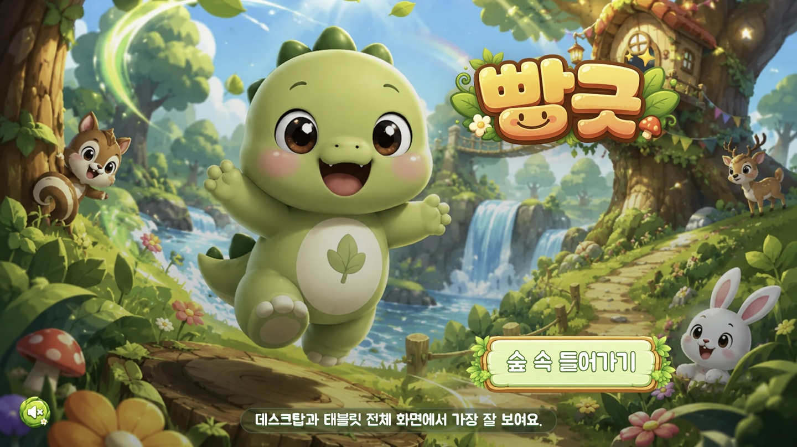
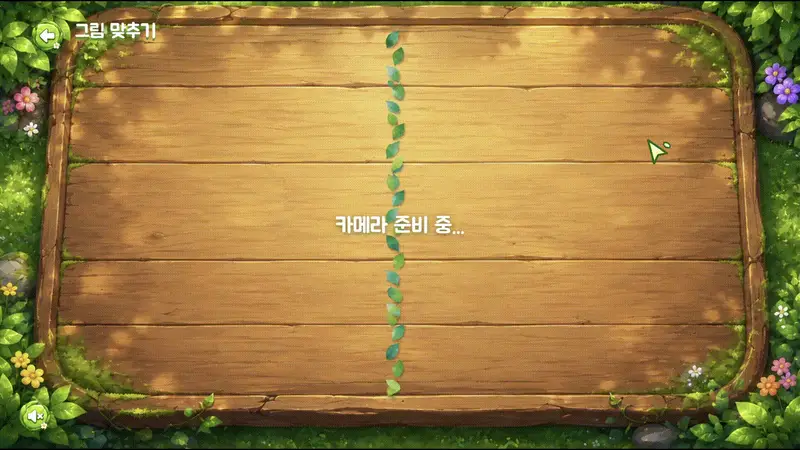
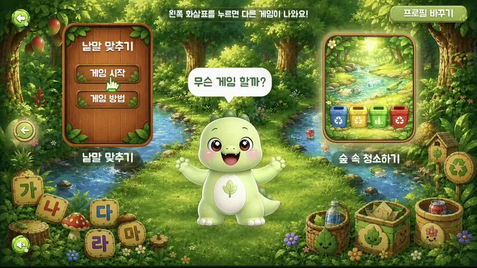
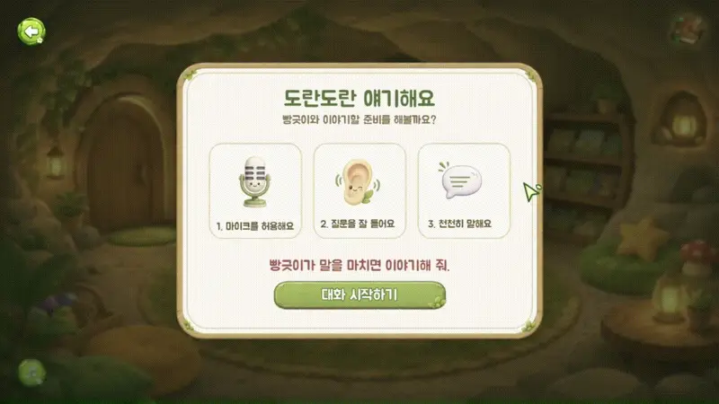
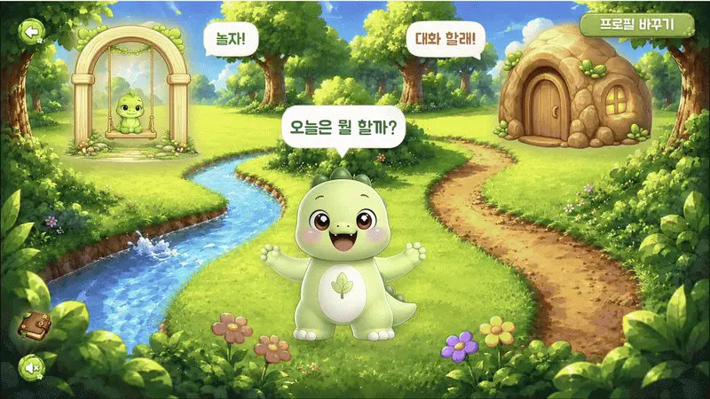
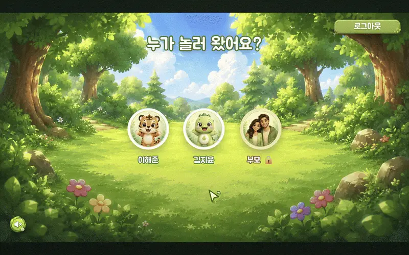
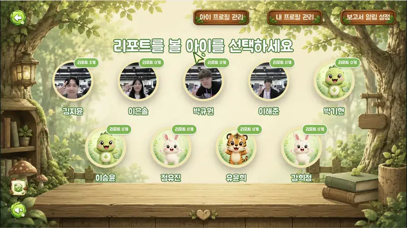

# 빵긋
**아이와 부모를 위한 모션 인식 게임·AI 일기 기반 케어 서비스**

아이는 카메라 앞에서 몸을 움직여 놀고, 놀이가 끝나면 캐릭터와 대화하며 하루를 일기로 남깁니다.
부모는 그 놀이 기록과 일기를 하루치 리포트로 받아 아이의 오늘을 확인합니다.

## 기획 배경

아이가 화면 앞에서 보내는 시간은 늘었지만, 대부분은 가만히 앉아 영상을 보는 시간입니다. 
동시에 부모는 아이의 하루를 알기 어렵습니다. "오늘 뭐 했어?"라는 질문에 아이는 아직 하루를 정리해 말하지 못하고,
부모는 아이가 무엇에 즐거워했는지 짐작만 하게 됩니다.

빵긋은 이 세 가지를 하나로 잇습니다.

- **몸을 쓰는 놀이로 바꿉니다.** 별도 기기 없이 웹캠만으로 손과 팔을 인식해, 아이가 직접 움직여야 놀이가 진행됩니다.
- **아이의 말을 하루로 남깁니다.** 놀이가 끝나면 캐릭터가 오늘 있었던 일을 물어보고, 그 대화를 아이 눈높이의 일기로 정리합니다.
- **부모에게는 관찰 기록으로 전달합니다.** 놀이 결과와 대화에서 드러난 감정·관심사를 모아 하루 리포트로 보여 줍니다.

## 주요 기능

### 모션 인식 놀이

웹캠으로 손과 팔의 움직임을 인식해 조작합니다. 

<table>
  <tr>
    <td align="center"></td>
    <td align="center"></td>
  </tr>
  <tr>
    <td align="center"><b>과일 자르기</b> 날아오는 과일 위로 손을 휘저어 자릅니다</td>
    <td align="center"><b>그림 맞추기</b> 두 카드에 공통으로 있는 그림을 양손으로 짚습니다</td>
  </tr>
  <tr>
    <td align="center"></td>
    <td align="center"></td>
  </tr>
  <tr>
    <td align="center"><b>낱말 맞추기</b> 그림을 보고 알맞은 글자 카드를 집어 빈칸에 넣습니다</td>
    <td align="center"><b>숲 속 청소하기</b> 떨어진 쓰레기를 집어 알맞은 분리수거 통에 담습니다</td>
  </tr>
</table>

### 캐릭터와의 하루 대화

놀이가 끝나면 캐릭터가 아이에게 오늘을 물어봅니다. 아이는 말로 대답하고, 캐릭터는 이어서 되묻습니다.

### 아이 일기

대화 내용을 아이가 읽을 수 있는 문장의 일기로 정리해 남깁니다. 지난 일기는 언제든 다시 볼 수 있습니다.

### 부모 리포트

놀이 기록과 대화에서 드러난 감정·관심사를 모아 하루 단위 리포트로 전달합니다.

### 프로필

한 계정에 여러 아이를 등록하고, 아이 모드와 부모 모드를 나눠 사용합니다.

<!-- TODO: 프로필 선택 화면 GIF -->

## 기술 스택

| 영역 | 사용 기술 |
| --- | --- |
| Frontend | React 19, TypeScript, Vite, Tailwind CSS, React Router, MediaPipe Tasks Vision |
| Backend | Java 21, Spring Boot 4.1, Spring Security, JPA, Flyway, Spring Batch, MySQL 8.4, Redis 7 |
| AI Server | Python 3.13, FastAPI, WebRTC(aiortc), Redis Stream |
| Infra | Docker Compose, Nginx, Jenkins, AWS EC2·S3, Prometheus, Grafana |

각 영역의 실행 방법은 exec를 참고하세요.

## 팀원

|                                                    | 이름  | 역할              |
|:--------------------------------------------------:|-----|-----------------|
|  | 김지윤 | 팀장 · Backend |
|  | 박규원 | Frontend |
|  | 이은솔 | Backend |
|  | 이해준 | Backend 리더 · AI |
|  | 정찬호 | Backend |

## Repository

- `frontend/`: React + TypeScript + Vite 클라이언트
- `backend/`: Spring Boot API 서버
- `ai-server/`: FastAPI 기반 대화·일기·리포트 서버
- `docs/`: 팀 컨벤션과 AI 에이전트 작업 방식

## Collaboration

- [Contributing Guide](CONTRIBUTING.md)
- [AI Agent Instructions](AGENTS.md)
- [Frontend Conventions](docs/FRONTEND_CONVENTIONS.md)
- [AI Agent Workflow](docs/AI_AGENT_WORKFLOW.md)
- [Design System](docs/DESIGN_SYSTEM.md)
- [UI/UX Requirements](docs/UI_UX_REQUIREMENTS.md)
