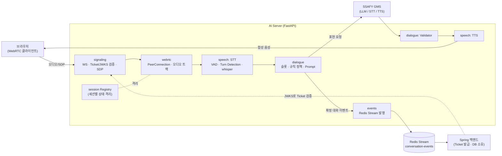

# AI Server

놀이 기반 아이 성장 기록 서비스의 **AI Realtime 서버**입니다.
**Python 3.12 + FastAPI** 기반이며, WebRTC(aiortc)로 아이와 실시간 음성 대화를 진행하고
STT·LLM·TTS 파이프라인과 규칙 기반 Dialogue 정책을 담당합니다.

- 백엔드(Spring): [`../backend`](../backend) — DB 소유, 인증, Realtime Ticket 발급
- 프론트엔드: [`../frontend`](../frontend) — 브라우저 WebRTC 클라이언트

## 🧾 프로젝트 개요

아이는 캐릭터와 음성으로 대화하며 하루를 이야기하고, 그 결과가 일기·리포트로 이어집니다.
이 서버는 그 **실시간 대화(Realtime)** 를 담당합니다.

- 브라우저와 **WebRTC**로 오디오를 주고받고, **STT → Dialogue 정책 → LLM → TTS** 파이프라인으로 응답합니다.
- 질문 목표·종료 판단은 **규칙 기반 정책**이 결정하고, LLM은 그 결과를 문장으로 표현만 합니다.
- 확정된 대화 이벤트를 **Redis Stream**(`conversation-events`)에 발행하면 Spring이 저장합니다.
- 아이 일기 요약, 일간 리포트 요약 등 **내부 REST API**도 제공합니다.

## 🚧 서비스 경계 (가장 중요)

- FastAPI는 **MySQL에 직접 접근하지 않습니다.** DB 소유는 Spring입니다.
- 사용자 Access Token은 FastAPI로 오지 않습니다. Realtime 접속은 Spring이 발급한 **일회용 Ticket(JWT)** 을 **JWKS**(`GET .../internal/v1/realtime/jwks`)로 검증합니다.
- FastAPI → Spring 확정 이벤트는 Redis Stream으로 발행하며, **발행 성공 ≠ MySQL 저장 완료**입니다.
- 원본 Audio, Partial STT, 전체 Transcript·Prompt·LLM 응답은 **저장·로그·fixture에 남기지 않습니다.**
- 실시간 상태(PeerConnection, Buffer, Queue, Task, `responseId`)는 **세션별로 격리**하고, 취소된 `responseId`와 낮은 `sessionEpoch`의 지연 결과는 폐기합니다.

## 📁 주요 폴더 구조

의존 방향은 **transport → session/pipeline → dialogue/speech → provider adapter** 입니다.
`dialogue/`의 순수 정책은 WebRTC·Redis·FastAPI 객체를 import하지 않습니다.

```
ai-server/
├── app/
│   ├── main.py            # FastAPI 앱 팩토리 (create_app), 라우터·수명주기 구성
│   ├── config.py          # 환경변수 기반 설정
│   ├── signaling/         # WebSocket 시그널링 — Ticket 인증·SDP 교환
│   ├── webrtc/            # RTCPeerConnection, 오디오 트랙
│   ├── session/           # 세션 Registry·Cleanup (세션별 상태 격리)
│   ├── realtime/          # Realtime 오케스트레이션
│   ├── speech/            # STT / TTS 파이프라인 (VAD·Turn Detection 포함)
│   ├── dialogue/          # 슬롯·규칙 정책·Prompt·Validator (순수 로직)
│   ├── events/            # DataChannel·Redis Stream 이벤트 계약
│   ├── api/               # 내부 REST (dialogue / child_diary / report / health / metrics)
│   ├── child_diary/       # 아이 일기 요약 생성
│   ├── report/            # 일간 리포트 요약 생성
│   └── providers/         # GMS(LLM/STT/TTS) 등 외부 provider 어댑터
├── tests/                 # app/ 구조를 그대로 따라감 (pytest)
├── requirements.txt
├── Dockerfile
├── .env.example
└── README.md
```

## ⚙️ 기술 스택

**Language / Framework**


**Realtime / Speech**


**Infra / Test**


## 🔊 실시간 대화 파이프라인



- 질문 목표·종료 판단은 `dialogue/`의 **규칙 기반 정책**이 결정하고, LLM(GMS)은 그 결과를 문장으로 표현만 합니다.
- STT는 배치(whisper) 방식이며 VAD·Turn Detection으로 발화 경계를 잡습니다.
- 확정 이벤트만 Redis Stream으로 발행되고, 원본 오디오·부분 STT는 발행/저장하지 않습니다.

## 📦 환경 설정

- 로컬 단독 실행은 `ai-server/.env` 를 사용합니다. 전체 항목은 [`.env.example`](.env.example) 참고.
- 배포(전체 스택)는 저장소 루트의 `.env` 와 `compose.yml` 이 담당합니다.
- Secret은 환경변수로만 주입하며 `.env` 는 커밋하지 않습니다.

### `.env` 예시 (주요 항목)

```properties
# SSAFY GMS (OpenAI 호환) — STT/LLM/TTS 공용 인증
GMS_KEY=
GMS_BASE_URL=
GMS_RESPONSE_MODEL=
GMS_REPORT_MODEL=
GMS_CHILD_DIARY_MODEL=

# STT / TTS
STT_MODEL=whisper-1
STT_LANGUAGE=ko
TTS_MODEL=gpt-4o-mini-tts
TTS_VOICE=shimmer

# WebRTC ICE — 빈 값이면 host 후보만(로컬). NAT 통과 배포에서만 STUN 지정.
REALTIME_STUN_URLS=

# Conversation Event 발행 (Redis Stream)
STREAM_PUBLISH_MAX_ATTEMPTS=3
STREAM_OUTBOX_SIZE=256
```

> 세부 튜닝값(VAD 민감도, 발화 길이·무음 임계, 타임아웃 등)은 `.env.example` 에 정리되어 있습니다.

## 🏁 실행 방법

Windows PowerShell + `.venv` 기준입니다.

```powershell
# (최초) 가상환경 및 의존성
python -m venv .venv
.\.venv\Scripts\python.exe -m pip install -r requirements.txt

# 개발 서버 (localhost:8000, 코드 변경 시 자동 리로드)
.\.venv\Scripts\python.exe -m uvicorn app.main:create_app --factory --reload --port 8000
```

- 컨테이너는 `uvicorn app.main:create_app --factory --host 0.0.0.0 --port 8000` 으로 기동합니다(`EXPOSE 8000`).
- 백엔드는 `AI_SERVER_BASE_URL`(기본 `http://127.0.0.1:8000`)로 이 서버를 호출합니다.

## 🧪 검증

```powershell
.\.venv\Scripts\python.exe -m pytest                 # 전체 테스트
.\.venv\Scripts\python.exe -m pytest tests/dialogue  # 특정 모듈
.\.venv\Scripts\python.exe -m compileall -q app tests
```

- 외부 의존 테스트는 opt-in 마커로 분리되어 기본 실행에서 제외됩니다: `gms`(실제 GMS 호출), `redis`(로컬 Redis 필요). 실행하려면 `-m gms` / `-m redis` 로 선택합니다.

## 🔌 API 요약

내부 REST는 모두 **Spring 전용**(`/internal/...`)이며, 시그널링은 브라우저용 WebSocket입니다.

### Realtime (브라우저)

| Protocol | Path | 설명 |
| --- | --- | --- |
| WebSocket | `/realtime/signaling` | WebRTC 시그널링 — Ticket 인증·SDP 교환 |

### Internal REST (Spring 백엔드용)

| Method | Path | 설명 |
| --- | --- | --- |
| POST | `/internal/v1/dialogue/opening` | 대화 오프닝(첫 질문) 생성 |
| POST | `/internal/v1/dialogue/turns` | 다음 턴(질문/응답) 생성 |
| POST | `/internal/v1/child-diaries/summary` | 아이 일기 요약 생성 |
| POST | `/internal/v1/reports/daily-summary` | 일간 리포트 요약 생성 |

### 운영

| Method | Path | 설명 |
| --- | --- | --- |
| GET | `/health/live` | Liveness 프로브 |
| GET | `/health/ready` | Readiness 프로브 |
| GET | `/metrics` | Prometheus 메트릭 |

## 📚 관련 문서

- [`../docs/AI_CONVENTIONS.md`](../docs/AI_CONVENTIONS.md) — ai-server 전체 컨벤션(구조, asyncio 격리, 이벤트·Redis 규칙, 테스트)
- 서비스 간 계약(AI 서버가 한쪽 당사자):
  [`CONVERSATION_TOPIC_CONTRACT`](../docs/CONVERSATION_TOPIC_CONTRACT.md),
  [`CHILD_DIARY_AI_CONTRACT`](../docs/CHILD_DIARY_AI_CONTRACT.md),
  [`REPORT_AI_CONTRACT`](../docs/REPORT_AI_CONTRACT.md)
- 서비스 경계·전체 규칙은 루트 [`../CLAUDE.md`](../CLAUDE.md), 이 디렉터리의 [`CLAUDE.md`](CLAUDE.md) 를 따릅니다.

## 📌 기타

- 유아 대상 서비스입니다. 실제 아이 이름·음성·영상·일기 원문은 샘플/fixture로 커밋하지 않습니다.
- Task 범위를 넘어 Spring·Frontend·다른 AI 모듈을 임의로 수정하지 않습니다.
