# Backend

놀이 기반 아이 성장 기록 서비스의 백엔드 API 서버입니다.
**Java 21 + Spring Boot 4.1** 기반으로 구축되었으며, **Gradle**로 빌드 및 의존성 관리를 수행합니다.

- 프론트엔드: [`../frontend`](../frontend) (React 19 + TypeScript + Vite)
- AI Realtime 서버: [`../ai-server`](../ai-server) (FastAPI, WebRTC/STT/LLM/TTS)

## 🧾 프로젝트 개요

아이는 게임과 캐릭터 대화로 하루를 일기로 남기고, 부모는 게임 결과와 일기 기반 리포트를 확인하는
유아 통합 교육 플랫폼입니다. 이 저장소는 그 백엔드로 **회원/인증, 자녀 프로필, 게임 세션 기록,
실시간 대화(Realtime) 세션 관리, 일간 리포트·알림, 아이 일기** 등 핵심 도메인 기능을 제공합니다.

DB 소유권은 이 Spring 서버에 있으며, FastAPI(AI 서버)는 MySQL에 직접 접근하지 않고
REST · Redis Stream · Realtime Ticket 계약으로만 통신합니다.

## 📁 주요 폴더 구조

도메인 우선(DDD 스타일)으로 패키지를 나눕니다. 각 도메인 안에
`controller / service / repository / entity / dto` 를 둡니다.

```
backend/
├── src/
│   ├── main/
│   │   ├── java/com/A501/backend/
│   │   │   ├── BackendApplication.java
│   │   │   ├── config/                 # 스프링 설정 (Security, CORS, WebClient 등)
│   │   │   ├── common/                 # 공통 모듈
│   │   │   │   ├── entity/             # BaseTimeEntity 등 공통 엔티티
│   │   │   │   ├── exception/          # ErrorCode + BusinessException + GlobalExceptionHandler
│   │   │   │   ├── storage/            # 프로필 이미지 저장소 (local / S3)
│   │   │   │   └── util/
│   │   │   └── domain/                 # 도메인별 비즈니스 로직
│   │   │       ├── auth/               # 회원/인증, JWT, Google OAuth, PIN
│   │   │       ├── child/              # 자녀 프로필
│   │   │       ├── childdiary/         # 아이 일기
│   │   │       ├── conversation/       # 실시간 대화 세션·턴·이벤트
│   │   │       ├── game/               # 게임 세션 및 결과 (Dobble / Fruit Ninja / 분리수거 / 낱말 맞추기)
│   │   │       └── report/             # 일간 리포트·알림
│   │   └── resources/
│   │       ├── application.yml         # 프로필별 설정 (local / prod)
│   │       └── db/migration/           # Flyway 마이그레이션 (V1 ~)
│   └── test/                           # 테스트 코드 (JUnit)
├── build.gradle                        # Gradle 빌드 설정
├── settings.gradle                     # Gradle 프로젝트 설정
├── SCHEMA                              # 사람이 읽는 스키마 참고 문서
└── README.md
```

## ⚙️ 기술 스택

**Language / Framework**


**Persistence**


**Infra / Docs**


## 🔐 인증 및 보안

- **JWT 기반 인증**: Access Token + HttpOnly Refresh Token 쿠키. Refresh Token은 SHA-256 해시로만 저장하고, rotation·재사용 감지를 지원합니다.
- **소셜 로그인**: Google OAuth2 (`AuthProvider = LOCAL | GOOGLE`).
- **PIN 보호**: 부모 화면 진입 등 민감 동작에 PIN 검증. 5회 실패 시 5분 잠금.
- **Realtime Ticket**: 사용자 Access Token은 AI 서버로 보내지 않습니다. Realtime 접속은 Spring이 발급한 **일회용 Ticket(JWT)** 을 FastAPI가 JWKS로 검증합니다.
- 원본 오디오·Partial STT·전체 Transcript·프롬프트는 저장·로그에 남기지 않습니다.

## 📦 환경 설정

- `application.yml` 하나에 `local` / `prod` 프로필 문서가 함께 들어 있습니다. 기본 프로필은 **`local`** 입니다.
- 로컬 실행 시 `backend/.env` 파일을 환경변수처럼 읽습니다(`spring.config.import: optional:file:./.env[.properties]`). 파일이 없으면 무시하고, 배포 환경에서는 컨테이너 환경변수가 우선합니다.
- `.env` 는 **`.properties` 형식으로 파싱**되므로 값에 따옴표를 쓰지 않습니다. 시크릿은 커밋하지 않습니다.

### `.env` 예시 (local)

`local` 프로필은 H2 인메모리 DB로 기동하므로 별도 DB 설정 없이도 실행됩니다.
대화 파이프라인·AI 서버 연동을 함께 확인하려면 아래 값을 채웁니다.

```properties
# 실행 프로필 (미지정 시 local)
SPRING_PROFILES_ACTIVE=local

# JWT / OAuth
JWT_SECRET=local-dev-only-change-me
GOOGLE_CLIENT_ID=

# Redis (대화 이벤트 스트림·Realtime 컨텍스트)
REDIS_HOST=127.0.0.1
REDIS_PORT=6379

# AI 서버 (FastAPI)
AI_SERVER_BASE_URL=http://127.0.0.1:8000

# S3 (프로필 업로드 사용 시에만. 기본 provider=local 은 메모리 가짜 저장소)
STORAGE_PROVIDER=local
# S3_UPLOAD_BUCKET=
# AWS_REGION=ap-northeast-2
```

### `prod` 추가 환경변수

`prod` 프로필은 MySQL과 시크릿을 환경변수로 주입해야 합니다.

```properties
SPRING_PROFILES_ACTIVE=prod
DB_URL=jdbc:mysql://...
DB_USERNAME=
DB_PASSWORD=
CORS_ALLOWED_ORIGINS=https://...
# Realtime Ticket 서명 키 (RSA PEM)
REALTIME_TICKET_PRIVATE_KEY_PEM=
REALTIME_TICKET_PUBLIC_KEY_PEM=
```

## 🏁 실행 방법

Windows PowerShell 기준입니다(`gradlew.bat`, macOS/Linux는 `./gradlew`).

```powershell
# 빌드
.\gradlew.bat clean build

# 애플리케이션 실행 (기본 local 프로필, H2 인메모리)
.\gradlew.bat bootRun
```

- IDE에서 `BackendApplication` 을 직접 실행해도 됩니다.
- `bootRun` 은 대화 파이프라인이 정상 동작하도록 `CONVERSATION_STREAM_ENABLED`, `CONVERSATION_STREAM_RECOVERY_ENABLED`, `REALTIME_RECONCILER_ENABLED` 를 켜고 뜹니다(디버깅 시 필요하면 조정).
- 전체 스택은 저장소 루트의 `compose.yml`(mysql · redis · ai-server · backend · nginx)로 함께 띄울 수 있습니다.

## 🧪 검증

```powershell
.\gradlew.bat test
.\gradlew.bat build
```

특정 도메인만 테스트: `.\gradlew.bat test --tests "com.A501.backend.domain.child.*"`

## 📖 API 문서

`local` 프로필에서 Swagger UI가 열립니다(`prod` 는 비활성화).

- Swagger UI: <http://localhost:8080/swagger-ui/index.html>
- H2 Console: <http://localhost:8080/h2-console> (JDBC URL `jdbc:h2:mem:a501;MODE=MySQL`, user `sa`)

## 🔌 API 요약 (도메인별)

전체 스펙은 Swagger UI를 기준으로 하며, 아래는 컨트롤러 매핑 요약입니다.

### auth — 인증 · 프로필 · PIN

| Method | Path | 설명 |
| --- | --- | --- |
| GET | `/api/auth/email/check` | 이메일 중복 확인 |
| POST | `/api/auth/signup` | 회원가입 |
| POST | `/api/auth/login` | 로컬 로그인 |
| POST | `/api/auth/token/refresh` | Access Token 재발급 |
| POST | `/api/auth/logout` | 로그아웃 |
| DELETE | `/api/auth/me` | 회원 탈퇴 |
| POST | `/api/auth/google` | 구글 로그인 |
| POST | `/api/auth/google/complete` | 구글 신규 가입 완료 |
| POST | `/api/auth/google/link` | 기존 계정에 구글 연동 |
| PATCH | `/api/auth/password` | 비밀번호 변경 |
| GET | `/api/profile` | 내 프로필 조회 |
| PATCH | `/api/profile/image` | 프로필 이미지(프리셋) 변경 |
| POST | `/api/profile/image/upload` | 프로필 이미지 업로드 |
| POST | `/api/profile/pin` | PIN 설정 |
| POST | `/api/profile/pin/verify` | PIN 검증 |
| PATCH | `/api/profile/pin` | PIN 변경 |

### child — 자녀 프로필

| Method | Path | 설명 |
| --- | --- | --- |
| GET | `/api/children/name/check` | 자녀 이름 중복 확인 |
| POST | `/api/children` | 자녀 등록 |
| GET | `/api/children` | 자녀 목록 조회 |
| PATCH | `/api/children/{childId}` | 자녀 정보 수정 |
| POST | `/api/children/{childId}/image` | 자녀 프로필 이미지 업로드 |
| DELETE | `/api/children/{childId}` | 자녀 삭제 (PIN 검증) |

### conversation — 대화 세션 · Realtime

| Method | Path | 설명 |
| --- | --- | --- |
| POST | `/api/v1/children/{childId}/conversations` | 대화 세션 생성 |
| GET | `/api/v1/conversations/{conversationId}` | 대화 세션 조회 |
| GET | `/api/v1/conversations/{conversationId}/turns` | 대화 턴 목록 조회 |
| POST | `/api/v1/conversations/{conversationId}/complete` | 대화 종료 |
| POST | `/api/v1/conversations/{conversationId}/text-turns` | 텍스트 턴 추가 |
| POST | `/api/v1/conversations/{conversationId}/realtime-session` | Realtime 세션 Ticket 발급 |
| GET | `/internal/v1/realtime/jwks` | Realtime Ticket 검증용 JWKS (내부, AI 서버용) |

### childdiary — 아이 일기 (base `/api/v1/children/{childId}`)

| Method | Path | 설명 |
| --- | --- | --- |
| POST | `.../conversations/{conversationId}/child-diary/preview` | 일기 미리보기 생성 |
| POST | `.../child-diaries` | 일기 저장 (attach) |
| GET | `.../child-diaries` | 일기 목록 조회 |
| GET | `.../child-diaries/{diaryId}` | 일기 상세 조회 |

### game — 게임 세션

| Method | Path | 설명 |
| --- | --- | --- |
| POST | `/api/game-sessions` | 게임 세션 결과 등록 |

### report — 리포트 · 알림

| Method | Path | 설명 |
| --- | --- | --- |
| GET | `/api/children/{childId}/reports` | 리포트 목록 조회 (기간·상태·페이지) |
| GET | `/api/children/{childId}/reports/{reportDate}` | 특정 날짜 리포트 상세 조회 |
| POST | `/api/children/{childId}/reports/{reportDate}/regenerate` | 실패 리포트 재생성 (Idempotency-Key) |
| POST | `/api/children/{childId}/reports/{reportDate}/generate` | 리포트 즉시 생성 |
| POST | `/api/admin/children/{childId}/reports/{reportDate}/generate` | (관리자) 과거 리포트 생성 |
| GET | `/api/notifications/unread` | 안 읽은 알림 조회 |
| PATCH | `/api/notifications/{notificationId}/read` | 알림 읽음 처리 |
| PATCH | `/api/notifications/reports/{reportId}/read` | 리포트 기준 알림 읽음 처리 |
| GET | `/api/notifications/preferences` | 알림 설정 조회 |
| PUT | `/api/notifications/preferences` | 알림 설정 변경 |
| GET | `/api/notifications/stream` | 알림 SSE 스트림 |

> `GET /harness`, `GET /realtime-harness` 등은 로컬 개발/디버깅용 도구 페이지입니다.

## 🔍 주요 기능

- ✅ JWT + Google OAuth2 기반 로그인 / 회원가입, Refresh Token rotation, 회원 탈퇴(soft delete + hard delete 스케줄러)
- ✅ 자녀 프로필 CRUD, 프로필 이미지(프리셋 / 웹캠 업로드 → S3 presigned URL), PIN 보호
- ✅ 실시간 대화(Realtime) 세션·턴 기록, Ticket 발급, 세션 격리/정리(Reconciler)
- ✅ 게임 세션 및 결과 저장(Dobble·Fruit Ninja·분리수거·낱말 맞추기)
- ✅ 일간 리포트 자동 생성(Spring Batch + 스케줄러) 및 재생성, SSE 기반 알림
- ✅ 아이 일기 생성/조회
- ✅ Actuator / Prometheus 메트릭 노출(`/actuator/prometheus`)

## 🔄 Conversation Redis Stream

FastAPI가 `conversation-events` Stream에 발행한 확정 대화 이벤트를
`spring-conversation-consumers` Consumer Group으로 처리합니다. 기본값은 비활성화이며,
Redis가 준비된 환경에서 다음 환경 변수로 활성화합니다.

```properties
CONVERSATION_STREAM_ENABLED=true
CONVERSATION_STREAM_RECOVERY_ENABLED=true
```

세부 poll · pending 복구 설정은 `application.yml` 의 `conversation.stream` 항목을 기준으로 합니다.
발행 성공이 곧 MySQL 저장 완료를 의미하지는 않습니다(멱등 처리 + pending 복구로 보장).

## 🗺️ ERD (데이터 모델)

**실선(`──`)** 은 DB에 실제로 존재하는 FK 제약, **점선(`··`)** 은 도메인 경계를 넘는 논리적 참조(FK 없음, 애플리케이션이 무결성 책임)입니다. 전체 컬럼은 [`SCHEMA`](SCHEMA)를 참고하세요.

```mermaid
erDiagram
    %% ── AUTH ──
    parent {
        bigint parent_id PK
        varchar email UK
        varchar provider "LOCAL|GOOGLE"
        varchar role "PARENT|ADMIN"
    }
    refresh_token {
        bigint id PK
        bigint parent_id FK
        varchar token_hash UK
    }

    %% ── CHILD ──
    child {
        bigint child_id PK
        bigint parent_id "ref parent"
        varchar name
        datetime deleted_at
    }

    %% ── CONVERSATION ──
    conversation_session {
        varchar conversation_id PK
        bigint child_id "ref child"
        varchar status
        varchar current_topic
    }
    conversation_topic_state {
        varchar conversation_topic_id PK
        varchar conversation_id "ref session"
        varchar topic_type "GAME|DAILY"
    }
    conversation_turn {
        varchar turn_id PK
        varchar conversation_id "ref session"
        varchar speaker "AI|CHILD"
    }
    conversation_game_session {
        varchar conversation_game_session_id PK
        varchar conversation_id "ref session"
        binary game_session_id "ref game_session"
    }
    conversation_event {
        varchar event_id PK
        varchar conversation_id "ref session"
        varchar event_type
    }

    %% ── GAME ──
    game {
        bigint game_id PK
        varchar game_code UK
    }
    game_session {
        binary game_session_id PK
        bigint child_id "ref child"
        bigint game_id FK
        int score
    }
    card_round {
        binary card_round_id PK
        binary game_session_id FK
        int round_no
    }
    fruit_ninja_result {
        binary game_session_id PK
    }
    fruit_ninja_fruit_result {
        binary fruit_result_id PK
        binary game_session_id "ref game_session"
    }
    recycling_game_result {
        binary game_session_id PK,FK
    }
    word_match_result {
        binary game_session_id PK,FK
    }
    word_match_problem_result {
        bigint word_match_problem_result_id PK
        binary game_session_id FK
    }
    game_rule_version {
        bigint rule_version_id PK
        varchar version_code UK
    }
    fruit_type {
        bigint fruit_type_id PK
        varchar fruit_code UK
    }
    fruit_score_config {
        bigint rule_version_id PK,FK
        bigint fruit_type_id PK,FK
    }

    %% ── REPORT ──
    daily_report {
        bigint report_id PK
        bigint child_id "ref child"
        date report_date
        varchar generation_status
    }
    report_game_result {
        bigint report_game_result_id PK
        bigint report_id "ref daily_report"
        binary game_session_id "ref game_session"
    }
    report_conversation_summary {
        bigint report_conversation_summary_id PK
        bigint report_id UK "ref daily_report"
    }
    report_generation_attempt {
        bigint attempt_id PK
        bigint report_id "ref daily_report"
    }
    report_manual_regeneration {
        bigint regeneration_id PK
        bigint report_id "ref daily_report"
        bigint parent_id "ref parent"
    }
    report_notification {
        bigint notification_id PK
        bigint parent_id "ref parent"
        bigint report_id "ref daily_report"
    }
    report_notification_preference {
        bigint preference_id PK
        bigint parent_id UK "ref parent"
    }
    report_notification_failure {
        bigint notification_failure_id PK
        bigint report_id "ref daily_report"
    }
    admin_report_generation_audit {
        bigint audit_id PK
        bigint admin_parent_id "ref parent"
        bigint report_id "ref daily_report"
    }

    %% ── CHILD DIARY ──
    child_diary {
        bigint child_diary_id PK
        bigint child_id "ref child"
        varchar conversation_id UK "ref session"
    }

    %% ── DB FK (실선) ──
    parent ||--o{ refresh_token : issues
    game ||--o{ game_session : played_as
    game_session ||--o{ card_round : rounds
    game_session ||--o| recycling_game_result : result
    game_session ||--o| word_match_result : result
    game_session ||--o{ word_match_problem_result : problems
    game_rule_version ||--o{ fruit_score_config : scores
    fruit_type ||--o{ fruit_score_config : scores

    %% ── 논리적 참조 (점선, 도메인 경계) ──
    parent ||..o{ child : owns
    child ||..o{ conversation_session : has
    child ||..o{ game_session : plays
    child ||..o{ daily_report : has
    child ||..o{ child_diary : has
    conversation_session ||..o{ conversation_topic_state : topics
    conversation_session ||..o{ conversation_turn : turns
    conversation_session ||..o{ conversation_game_session : links
    conversation_session ||..o{ conversation_event : events
    conversation_session ||..o| child_diary : produces
    game_session ||..o| fruit_ninja_result : result
    game_session ||..o{ fruit_ninja_fruit_result : fruits
    game_session ||..o{ conversation_game_session : linked
    game_session ||..o{ report_game_result : snapshot
    daily_report ||..o{ report_game_result : includes
    daily_report ||..o| report_conversation_summary : summary
    daily_report ||..o{ report_generation_attempt : attempts
    daily_report ||..o{ report_manual_regeneration : regen
    daily_report ||..o{ report_notification : notifies
    daily_report ||..o{ report_notification_failure : failures
    parent ||..o{ report_notification : receives
    parent ||..o| report_notification_preference : pref
    parent ||..o{ report_manual_regeneration : requests
    parent ||..o{ admin_report_generation_audit : audited
    daily_report ||..o{ admin_report_generation_audit : audited
```



## 🗄️ DB 스키마 / 마이그레이션

- 운영 스키마 변경은 **Flyway 마이그레이션**(`src/main/resources/db/migration/`)으로만 적용합니다.
- `local`(H2)은 `ddl-auto=create-drop` 로 엔티티에서 매번 생성하고, `prod`(MySQL)은 Flyway 적용 후 `ddl-auto=validate` 로 일치 여부를 검증합니다.
- 도메인 간 참조에는 FK를 걸지 않습니다(경계 유지, 애플리케이션이 무결성 책임). 사람이 읽는 전체 스키마 정리는 [`SCHEMA`](SCHEMA) 참고.

## 📚 관련 문서

- [`../docs/BACKEND_CONVENTIONS.md`](../docs/BACKEND_CONVENTIONS.md) — 패키지 구조·DTO·예외·트랜잭션 규칙
- 서비스 간 계약(백엔드가 한쪽 당사자):
  [`CONVERSATION_TOPIC_CONTRACT`](../docs/CONVERSATION_TOPIC_CONTRACT.md),
  [`CHILD_DIARY_BACKEND_CONTRACT`](../docs/CHILD_DIARY_BACKEND_CONTRACT.md),
  [`CHILD_DIARY_AI_CONTRACT`](../docs/CHILD_DIARY_AI_CONTRACT.md),
  [`REPORT_AI_CONTRACT`](../docs/REPORT_AI_CONTRACT.md)
- [`../docs/MONITORING.md`](../docs/MONITORING.md), [`../docs/OPERATIONS_RUNBOOK.md`](../docs/OPERATIONS_RUNBOOK.md) — 모니터링·운영 절차

## 📌 기타

- 유아 대상 서비스입니다. 실제 아이 이름·음성·영상·일기 원문은 샘플/픽스처로 커밋하지 않습니다.
- `prod` 환경에서는 반드시 HTTPS 설정과 함께 JWT 쿠키 보안(`app.cookie.secure=true`)을 유지하세요.
