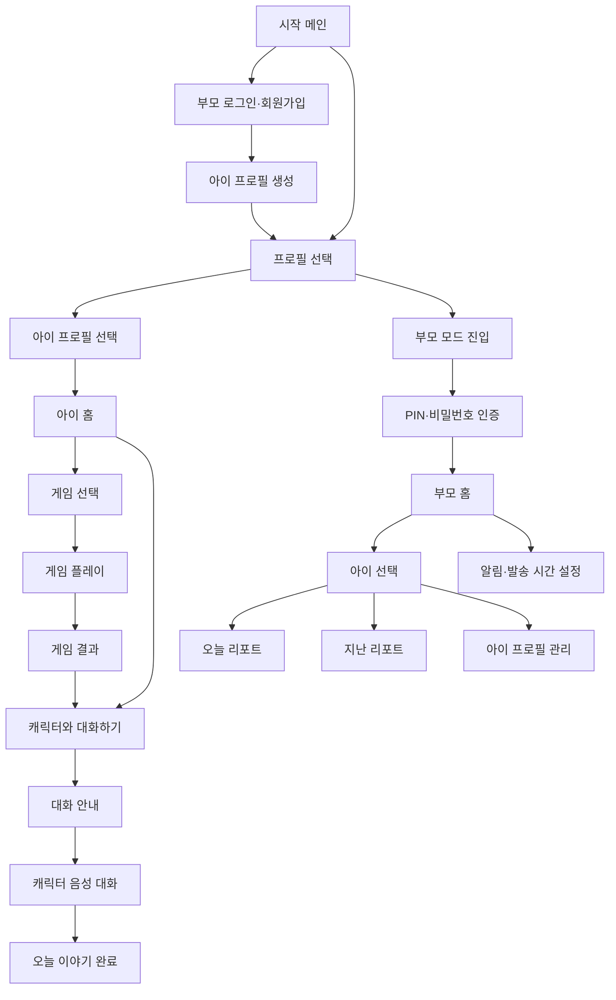

# UI/UX Requirements

놀이 기반 아이 성장 기록 서비스의 화면 범위와 기본 사용자 흐름입니다.

## 가입 및 최초 진입

- 부모는 소셜 회원가입 또는 이메일 회원가입을 사용할 수 있습니다.
- 소셜 회원가입은 카카오, 구글에서 받은 정보를 그대로 사용하며 추가 부모 정보 입력을 요구하지 않습니다.
- 이메일 회원가입은 서비스에 필요한 부모 정보를 별도로 입력합니다.
- 부모 회원가입 완료 후 바로 아이 프로필 생성 화면으로 이동합니다.
- 이후 앱을 실행하면 자동 로그인 상태에서 프로필 선택 화면으로 진입합니다.

## UI Epics

| ID | 요구사항명 | 설명 | 우선순위 |
| --- | --- | --- | --- |
| UI-EPIC-01 | 프로필 선택 및 모드 분리 | 프로필을 선택하고 아이 모드와 부모 모드를 명확하게 구분한다. | M |
| UI-EPIC-02 | 아이 홈 | 아이가 게임 또는 캐릭터와의 대화를 선택할 수 있는 홈 화면을 제공한다. | M |
| UI-EPIC-03 | 게임 진행 | 게임 선택, 플레이, 정답·오답 피드백 및 결과 확인 화면을 제공한다. | M |
| UI-EPIC-04 | 캐릭터 음성 대화 | 대화 안내, 음성 입력·출력, 진행 상태 및 대화 완료 화면을 제공한다. | M |
| UI-EPIC-05 | 부모 인증 및 홈 | 부모 인증을 거쳐 부모 전용 홈과 아이별 정보에 접근할 수 있도록 한다. | M |
| UI-EPIC-06 | 부모 리포트 | 아이의 게임·대화 데이터를 기반으로 생성된 오늘 및 지난 리포트를 제공한다. | M |
| UI-EPIC-07 | 아이 프로필 관리 | 부모가 아이 프로필을 추가·수정·삭제하고 다자녀 프로필을 관리할 수 있도록 한다. | M |
| UI-EPIC-08 | 리포트 알림 설정 | 리포트 발송 여부와 기본 발송 시간을 제공하고, 부모가 발송 시간을 설정할 수 있도록 한다. | M |
| UI-EPIC-09 | 공통 UI 및 예외 처리 | 로딩, 네트워크 오류, 서비스 처리 실패 등 공통 상태에 대한 안내 화면을 제공한다. | M |
| UI-EPIC-10 | 접근성 및 사용성 | 아이와 부모 사용자의 특성에 맞는 글자, 버튼, 색상, 음성 안내 및 화면 구조를 제공한다. | M |

## Main Screen Flow

## Child Mode UX Rules

- 아이 화면은 큰 버튼, 짧은 문장, 명확한 선택지를 기본으로 합니다.
- 게임 결과는 칭찬과 다음 행동 안내 중심으로 보여줍니다.
- 오답과 실패는 직접 강조하지 않고, 다시 시도할 수 있는 긍정 피드백으로 표현합니다.
- 캐릭터 대화는 게임 완료 후 자연스럽게 이어지도록 구성합니다.
- 아이가 혼자 조작할 수 있도록 화면당 주요 행동은 1개에서 2개로 제한합니다.

## Parent Mode UX Rules

- 부모 모드 진입 전 PIN 또는 비밀번호 인증을 거칩니다.
- 부모 홈에서는 아이 선택, 오늘 리포트, 지난 리포트, 프로필 관리, 알림 설정으로 빠르게 이동할 수 있어야 합니다.
- 리포트는 관찰과 요약 중심으로 표현하고, 의학적·발달적 진단처럼 단정하지 않습니다.
- 다자녀 사용을 고려해 현재 선택된 아이가 항상 명확히 보여야 합니다.

## Common States

- 로딩: 현재 처리 중인 일을 짧게 알려줍니다.
- 네트워크 오류: 다시 시도할 수 있는 행동을 제공합니다.
- 서비스 처리 실패: 아이 화면에서는 불안감을 주지 않는 문구를 사용합니다.
- 권한 필요: 카메라, 마이크 권한이 필요한 이유를 짧게 설명합니다.
- 빈 상태: 다음에 할 수 있는 행동을 함께 제공합니다.
