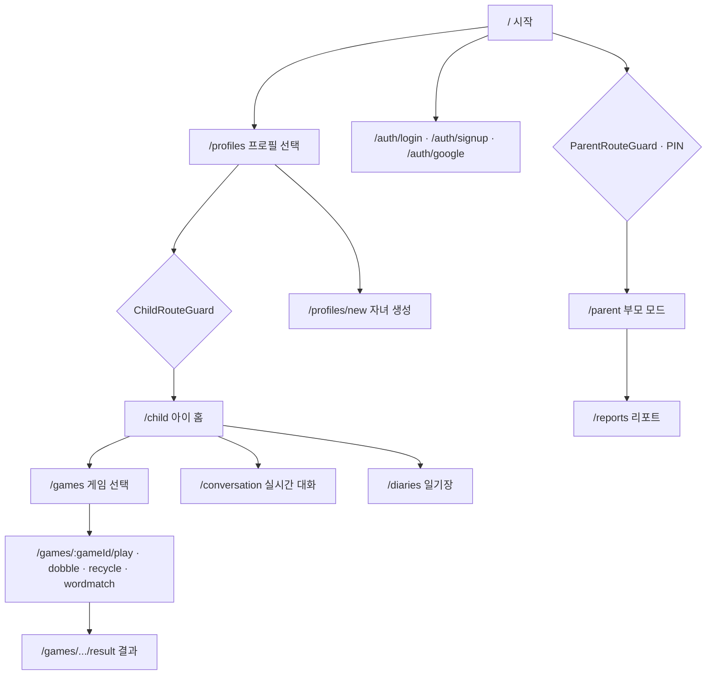

# Frontend

놀이 기반 아이 성장 기록 서비스의 프론트엔드입니다.
**React 19 + TypeScript + Vite** 기반이며, 스타일은 **Tailwind CSS 4**, 라우팅은 **React Router 7** 을 사용합니다.

- 백엔드(Spring): [`../backend`](../backend) — REST API·인증·Realtime Ticket 발급
- AI Realtime 서버: [`../ai-server`](../ai-server) — 브라우저와 WebRTC로 실시간 음성 대화

## 🧾 프로젝트 개요


- **아이**는 게임(도블·과일 자르기·분리수거·낱말 맞추기)을 하고, 캐릭터와 **실시간 음성 대화**로 하루를 이야기한 뒤 일기로 남깁니다.
- **부모**는 PIN으로 부모 모드에 진입해 게임 결과와 일기 기반 **리포트**를 확인합니다.
- 손동작 기반 게임은 브라우저에서 **MediaPipe**(hand/pose tracking)로 카메라 입력을 처리합니다.

## 📁 주요 폴더 구조

```
frontend/
├── src/
│   ├── main.tsx            # 앱 진입점
│   ├── App.tsx             # RouterProvider 등 최상위 구성
│   ├── index.css           # Tailwind 4 · 공유 디자인 토큰(theme)
│   ├── routes/             # 라우터 정의 (router.tsx) · lazyPages
│   ├── pages/              # 화면 단위 컴포넌트
│   ├── components/         # 재사용 UI·레이아웃 (auth / game / conversation / parent / ui ...)
│   ├── features/           # 도메인 기능 모듈 (games / reports)
│   ├── api/                # 백엔드(Spring) REST 클라이언트 (auth·children·conversations ...)
│   ├── lib/                # 공용 로직 (realtime WebRTC, cn() 유틸 등)
│   ├── hooks/              # 커스텀 훅 (BGM, 카메라, 손·포즈 트래킹 ...)
│   ├── utils/
│   └── assets/             # 이미지·오디오 등 정적 자원
├── public/                 # 정적 파일
├── vite.config.ts          # Vite 설정 (alias @ → ./src)
├── .env.example
└── README.md
```

- import alias는 `@/*` 이며 `./src` 를 가리킵니다.
- 백엔드와의 REST는 `src/api/*`, AI 서버와의 실시간 대화는 `src/lib/realtime` 에 모여 있습니다.

## ⚙️ 기술 스택

**Core**


**Style / UI**


**Realtime / Vision**


**Tooling**


## 🗺️ 라우팅 맵

가드(`ChildRouteGuard` / `ParentRouteGuard`)가 접근 영역을 나눕니다. 세부 경로는 [`src/routes/router.tsx`](src/routes/router.tsx) 참고.



## 📱 화면(라우트) 요약

### 공개 · 인증

| Path | Page | 설명 |
| --- | --- | --- |
| `/` | StartPage | 시작 화면 |
| `/profiles` | ProfileSelectPage | 자녀 프로필 선택 |
| `/auth/login` | EmailLoginPage | 이메일 로그인 |
| `/auth/signup` | EmailSignupPage | 이메일 회원가입 |
| `/auth/google` | GoogleBirthdatePage | 구글 로그인(생년월일 입력) |
| `/profiles/new` | ParentProfilePage | 자녀 프로필 생성 (온보딩, ParentRouteGuard) |

### 아이 (ChildRouteGuard)

| Path | Page | 설명 |
| --- | --- | --- |
| `/child` | ChildHomePage | 아이 홈 |
| `/games` | GameEntryPage | 게임 선택 |
| `/games/more` | MoreGamesPage | 더 많은 게임 |
| `/games/:gameId/guide` | GameGuidePage | 게임 방법 안내 |
| `/games/:gameId/play` | GamePlayPage | 게임 플레이 (공통) |
| `/games/:gameId/result` | GameResultPage | 게임 결과 (공통) |
| `/games/dobble/play` · `/result` | Dobble{Play,Result}Page | 도블(그림 맞추기) |
| `/games/recycle/play` · `/result` | Recycle{Play,Result}Page | 분리수거 |
| `/games/wordmatch/play` · `/result` | WordMatch{Play,Result}Page | 낱말 맞추기 |
| `/conversation` | ConversationPage | 캐릭터와 실시간 음성 대화 |
| `/diaries` | DiaryListPage | 일기장 |

### 부모 (ParentRouteGuard · PIN)

| Path | Page | 설명 |
| --- | --- | --- |
| `/parent` | ParentModePage | 부모 모드 |
| `/reports` | ReportListPage | 리포트 목록 (상세는 목록에서 인라인 전개) |

## 🔗 백엔드·AI 서버 연동

- **REST (→ Spring)**: `src/api/*.ts` 모듈이 담당하며 base URL은 `VITE_API_BASE_URL`(기본 `http://localhost:8080`)입니다. 인증은 HttpOnly 쿠키 기반이라 요청에 자격증명을 함께 보냅니다.
- **Realtime (→ AI 서버)**: `/conversation` 화면에서 Spring이 발급한 **일회용 Ticket**을 받아 `src/lib/realtime` 의 WebRTC 클라이언트로 AI 서버에 접속합니다. 오디오는 브라우저 ↔ AI 서버 간 P2P로 흐릅니다.
- **Vision**: 손동작 게임은 `useCameraStream` · `useHandTracking` · `usePoseLandmarker`(MediaPipe)로 카메라 프레임을 처리합니다.

## 📦 환경 설정

`.env.example` 을 `.env.local` 로 복사한 뒤 로컬 값에 맞게 수정합니다. (Vite는 `VITE_` 접두사 변수만 클라이언트에 노출)

```properties
VITE_API_BASE_URL=http://localhost:8080
VITE_GOOGLE_CLIENT_ID=
```

## 🏁 실행 방법

```bash
npm install
npm run dev       # 개발 서버 (Vite)
npm run build     # tsc -b && vite build
npm run preview   # 빌드 결과 미리보기
```

## 🧪 검증

변경 후 기본 검증 순서는 **format:check → lint → build** 입니다. 별도 테스트 프레임워크는 없습니다.

```bash
npm run format:check   # Prettier 확인
npm run lint           # Oxlint
npm run build          # 타입 체크 + 프로덕션 빌드
```

## 🎨 디자인 토큰

공유 Tailwind 테마 토큰은 [`src/index.css`](src/index.css) 에 정의되어 있습니다. 색·간격 등은 유틸리티 클래스로 우선 표현하고, 반복되는 UI가 생기면 `src/components/` 로 분리합니다. 클래스 합성은 `src/lib/utils.ts` 의 `cn()` 을 사용합니다.

## 📚 관련 문서

- [`../docs/FRONTEND_CONVENTIONS.md`](../docs/FRONTEND_CONVENTIONS.md) — 디렉터리·라우팅·스타일 규칙
- [`../docs/UI_UX_REQUIREMENTS.md`](../docs/UI_UX_REQUIREMENTS.md) — 화면 흐름과 UI 범위의 우선 기준
- [`../docs/DESIGN_SYSTEM.md`](../docs/DESIGN_SYSTEM.md) — 디자인 시스템
- 전체 규칙은 루트 [`../CLAUDE.md`](../CLAUDE.md), [`../AGENTS.md`](../AGENTS.md) 를 따릅니다.

## 📌 기타

- 유아 대상 서비스입니다. 아이 화면은 짧고 긍정적인 문장을 쓰고 실패·오답·낮은 점수를 직접 강조하지 않습니다. 부모 화면은 관찰·요약 중심입니다.
- 사용하지 않는 패키지나 미래 기능용 추상화는 미리 추가하지 않습니다.
